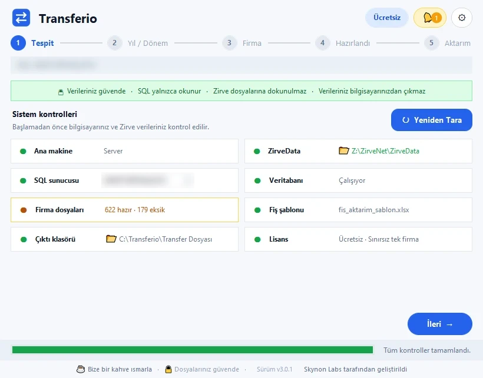
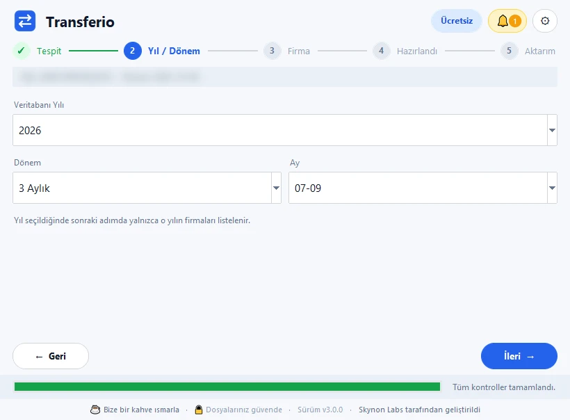
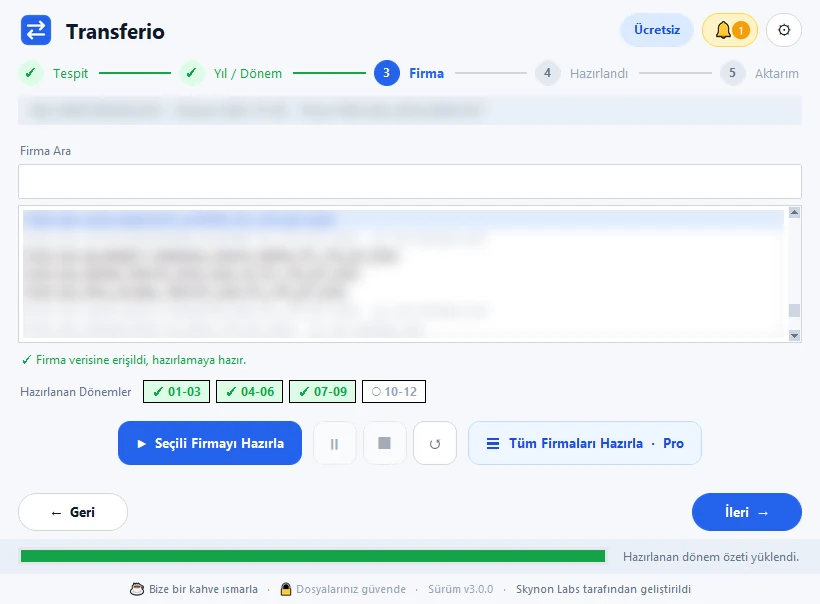
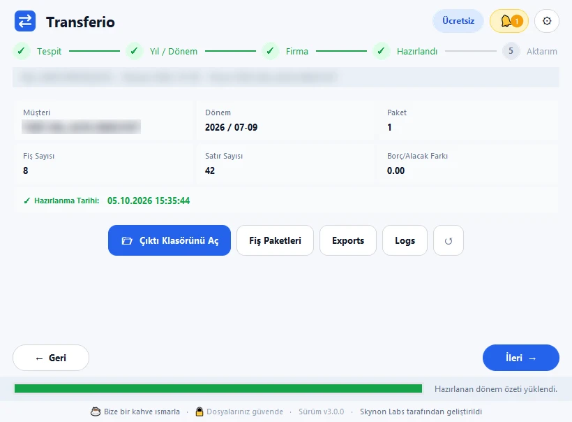
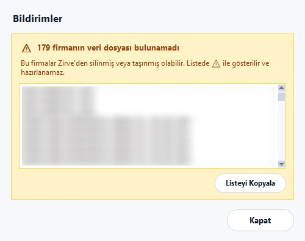
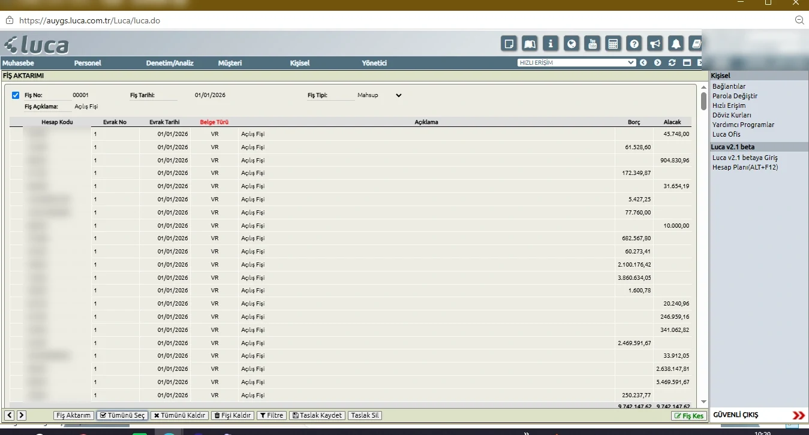
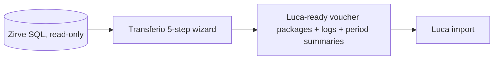

# Transferio — showcase

Windows desktop app that prepares voucher and chart-of-accounts files for moving accounting data from Zirve to Luca, two widely used Turkish accounting systems.

**Website:** [skynonlabs.com/transferio](https://skynonlabs.com/transferio.html) · [Türkçe](README.tr.md)

> Showcase only; source code is private.

| | |
|---|---|
|  |  |
|  |  |
|  |  |

## How it works

- **Read-only by design:** never writes to the database or touches Zirve files; output goes to a separate folder.
- **Real pre-flight checks:** host, SQL server, database connection, company data files, template, output folder and licence are actually tested before you start.
- **Safe packaging:** vouchers split into 50-voucher packages with debit/credit balance checks.
- Free for a single company; bulk preparation in Pro.

© 2026 Skynon Labs Ltd. All rights reserved. · hello@skynonlabs.com
